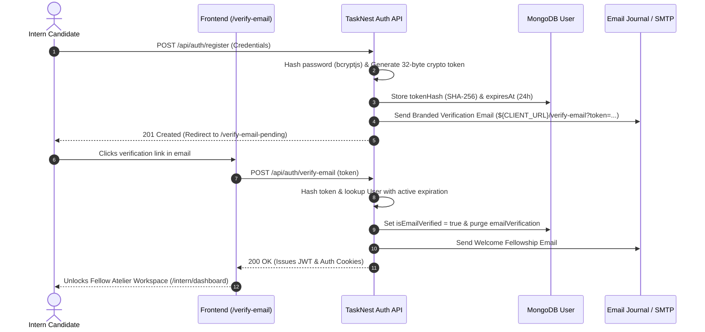
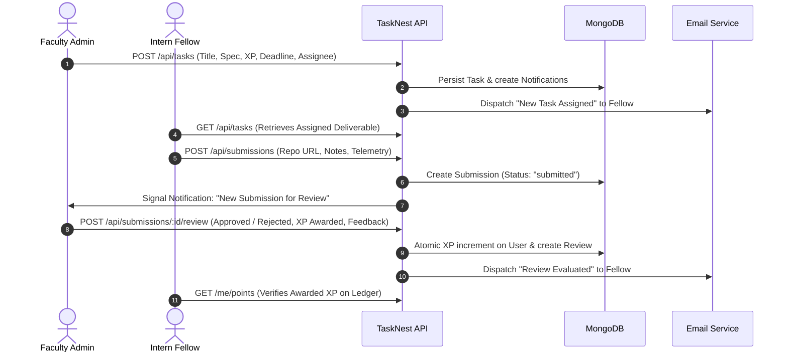

# TaskNest – Task Management & Intern Performance Portal

An architectural monograph-grade task management and performance evaluation portal for engineering fellows and research faculty. Designed with the warm, editorial aesthetic of the Google Stitch project: ivory/beige palettes, glassmorphic cards, serif headings (`Playfair Display`), clean typography (`Manrope`), and rigorous distributed systems workflows.

---

## 🛠 Tech Stack

### Frontend
- **Framework:** React.js 18 + Vite
- **Styling:** Tailwind CSS with custom Stitch design tokens (`surface`, `secondary`, `display`, `Playfair Display`)
- **Routing:** React Router DOM v6
- **HTTP Client:** Axios with bearer token interceptors & cross-origin cookies
- **Data Visualization:** Recharts (XP velocity charts, trajectory area graphs)
- **Icons:** Material Symbols & Lucide React

### Backend
- **Runtime:** Node.js (ES modules)
- **Framework:** Express.js
- **Database & ODM:** MongoDB + Mongoose
- **Authentication & Security:** JWT (Access + Refresh tokens), `bcryptjs` password hashing, Role-Based Access Control (RBAC)
- **Validation:** Zod schema validation middleware
- **Email:** Nodemailer / Resend transport integration with fallback preview

---

## 🏛 Design System & Palette (Google Stitch Reference)

Follows the Stitch reference with warm beige, ivory, cream, muted bronze, and charcoal tones:
- **Surface:** `#fff8f2` (Warm Ivory / Beige)
- **Surface Bright:** `#ffffff` (Elevated Cards)
- **Surface Container High:** `#eae4d8` (Muted Panels)
- **Primary:** `#201e19` (Charcoal Slate)
- **Secondary:** `#74593f` (Muted Warm Bronze)
- **Typography:**
  - Headings: `Playfair Display`, Serif editorial headers
  - Body & Code: `Manrope`, JetBrains Mono for cryptographic digests and spec codes

---

## 👥 Default Credentials

Run `npm run seed` in `backend` to populate the database with active test users, sprint tasks, and monograph submissions:

| Role | Name | Email | Password | Status |
| :--- | :--- | :--- | :--- | :--- |
| **Faculty Admin** | Elena Rostova | `admin@tasknest.org` | `Admin@12345` | Verified |
| **Intern Fellow** | Julian Vance | `julian.vance@tasknest.org` | `Password@123` | Verified |
| **Intern Fellow** | Lin Zhang | `lin.zhang@tasknest.org` | `Password@123` | Verified |
| **Intern Fellow** | Beatrice Nat | `betrice.nat@tasknest.org` | `Password@123` | Verified |
| **Unverified Fellow** | Unverified Fellow | `unverified.fellow@tasknest.org` | `Password@123` | Pending Verification |

> [!NOTE]
> Public registration on `/register` creates an intern account in unverified status (`isEmailVerified = false`) and dispatches a single-use cryptographically hashed verification link. Unverified interns cannot sign in or access protected features until verified. Admin accounts are provisioned exclusively via secure seed or system administrator setup.

---

## 🔐 Cryptographic Email Verification Protocol



---

## 🔄 Core Business Workflow



---

## 🚀 Getting Started

### 1. Prerequisites
- Node.js 18+ installed
- MongoDB instance running locally on `mongodb://127.0.0.1:27017` (or remote URI specified in `backend/.env`)

### 2. Backend Setup
```bash
cd backend
npm install
npm run seed       # Seeds admin, interns, tasks, reviews, and signals
npm test           # Runs the 23-test automated API test suite
npm run dev        # Starts the API server on http://localhost:5000
```

### 3. Frontend Setup
```bash
cd frontend
npm install
npm run build      # Verifies Vite production bundle build
npm run dev        # Launches Vite development server on http://localhost:5173
```

### 4. Root Helper Scripts
From the project root directory:
```bash
npm run dev:backend    # Starts backend in dev mode
npm run dev:frontend   # Starts Vite dev server
npm run test:backend   # Executes backend automated test suite
npm run build:frontend # Builds production frontend dist
npm run seed           # Re-seeds the MongoDB database
```

---

## 🧪 Automated Testing
The backend includes a comprehensive 41-test API verification suite in `backend/tests/api.test.js`:
- Health check endpoint verification (`GET /healthz`)
- JWT authentication for Admin & Intern
- RBAC authorization check (Intern forbidden `403` from `/api/users`)
- Public registration restriction to `intern` role (forces `role: intern`)
- **Cryptographic Email Verification Lifecycle (Suite 2b):**
  - Registration marks account with `isEmailVerified: false`
  - Unverified login rejected with `403 Forbidden` (`code: EMAIL_NOT_VERIFIED`)
  - Verification email journaled with 64-char hex cryptographic token
  - Resend verification enforces 60-second cooldown (`429 RESEND_COOLDOWN`)
  - Invalid token rejected with `400 Bad Request`
  - Valid token verification marks `isEmailVerified: true` and issues session
  - Verified candidate logs in with `200 OK`
  - Re-using consumed token rejected with `400 Bad Request`
  - Resend on verified account returns `alreadyVerified: true`
- Task creation, spec validation, and audience notification
- Submission deduplication (`409 Conflict` on duplicate submission)
- Evaluation & single-award guarantee (`409 Conflict` prevents double-awarding XP)
- Notifications retrieval & mark-as-read

