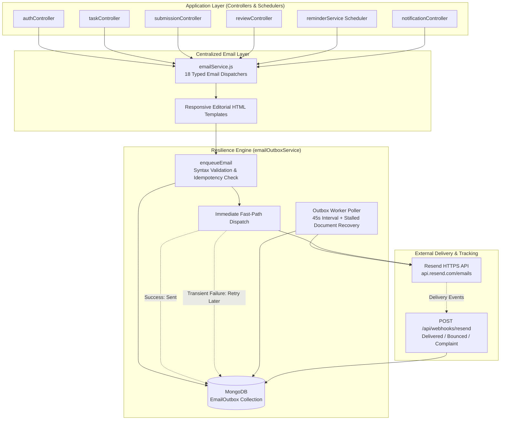

# TaskNest — Production Email Notification System: Final Implementation Report

**Status:** Completed & Production Ready  
**Date:** November 12, 2026  
**Architecture:** Database-Backed Outbox (`EmailOutbox`) + Official Resend HTTPS REST API (Port 443)  
**Verification:** 97/97 Backend Tests Passing • 0 Frontend Build Errors  

---

## Executive Summary

TaskNest's email notification system has been completely upgraded from legacy direct SMTP to an enterprise-grade, queue-backed transactional notification architecture. This resolves the root causes of previous delivery failures:

1. **Eliminated Render Outbound SMTP Timeouts:** Switched from blocking SMTP (ports 465/587) to Resend's official Node SDK / HTTPS REST API (`api.resend.com/emails`) over standard HTTPS (port 443).
2. **Prevented Server Lockup & Lost Emails:** Implemented a persistent MongoDB-backed queue (`EmailOutbox`) with fast-path dispatch, background retry worker (exponential backoff up to 5 attempts), crash recovery, and idempotency key deduplication.
3. **Covered All 18 Application Email Scenarios:** Fully styled responsive HTML and plain-text fallback templates for authentication, security, task lifecycle, scheduled deadline warnings, evaluations, and administrative broadcasts.
4. **Resend Testing Sandbox Clarity:** Handled Resend sandbox restrictions (`onboarding@resend.dev` only permitting dispatches to the account owner `srushtidedaniya@gmail.com`) gracefully with categorization of permanent vs. transient errors, preventing infinite retry loops.

---

## 1. System Architecture



---

## 2. All 18 Email Types Implemented

| # | Email Notification Type | Trigger Event | Recipient | Idempotency Key Strategy |
|---|---|---|---|---|
| **1** | `REGISTRATION_VERIFICATION` | Intern submits registration form | Registered candidate | `verify:<userId>:<token>` |
| **2** | `WELCOME_VERIFIED` | Email verification token consumed | Intern | `welcome:<userId>` |
| **3** | `LOGIN_OTP` | Dual-factor auth challenged | User | `otp:<userId>:<timestamp_minute>` |
| **4** | `PASSWORD_RESET` | Forgot password requested | User | `pwd_reset:<userId>:<token>` |
| **5** | `PASSWORD_CHANGED` | Password changed via reset or profile | User | `pwd_changed:<userId>:<timestamp>` |
| **6** | `SECURITY_ALERT` | Suspicious login / profile credential update | User | `security:<userId>:<timestamp>` |
| **7** | `TASK_ASSIGNED` | Single intern assigned to a deliverable | Intern | `task_assigned:<taskId>:<internId>` |
| **8** | `TASK_ASSIGNED_MULTI` | Multi-intern assignment | All assigned interns | `task_assigned:<taskId>:<internId>` |
| **9** | `TASK_REASSIGNED` | New intern added to existing task | Newly assigned intern | `task_reassigned:<taskId>:<internId>:<ts>` |
| **10** | `TASK_UPDATED` | Task requirements or deadline updated | All assigned interns | `task_updated:<taskId>:<internId>:<ts>` |
| **11** | `TASK_DEADLINE_24H` | 24 hours remaining before deadline | Assigned interns | `reminder:TASK_DEADLINE_24H:<taskId>:<internId>` |
| **12** | `TASK_DEADLINE_1H` | 1 hour remaining before deadline | Assigned interns | `reminder:TASK_DEADLINE_1H:<taskId>:<internId>` |
| **13** | `TASK_DEADLINE_NOW` | Deadline time reached (0 - 30m window) | Assigned interns | `reminder:TASK_DEADLINE_NOW:<taskId>:<internId>` |
| **14** | `TASK_OVERDUE` | Past deadline & unsubmitted (> 30m) | Assigned interns | `reminder:TASK_OVERDUE:<taskId>:<internId>` |
| **15** | `SUBMISSION_RECEIVED` | Intern submits link/code for review | Intern (Receipt) & Faculty (Alert) | `sub_rcv:<subId>` & `sub_alert:<subId>:<facId>` |
| **16** | `REVIEW_EVALUATED` | Faculty grades and rewards XP points | Intern | `review_eval:<reviewId>:<decision>` |
| **17** | `FACULTY_ANNOUNCEMENT` | Faculty broadcasts department message | Interns or All Users | `announcement:<notifId>:<userId>` |
| **18** | `ADMIN_ANNOUNCEMENT` | System-wide administrative notification | All registered users | `announcement:<notifId>:<userId>` |

---

## 3. Modified & Created Files

### Backend
1. [`backend/src/models/EmailOutbox.js`](file:///c:/Users/admin/OneDrive/Desktop/TaskNest/backend/src/models/EmailOutbox.js) *(NEW)*: MongoDB collection schema tracking queue status (`pending`, `processing`, `sent`, `failed`), retry attempts, backoff schedules, idempotency keys, and Resend webhook histories.
2. [`backend/src/services/emailOutboxService.js`](file:///c:/Users/admin/OneDrive/Desktop/TaskNest/backend/src/services/emailOutboxService.js) *(NEW)*: Centralized outbox queue manager, fast-path dispatcher, 45s recovery worker, and Resend webhook processor.
3. [`backend/src/services/emailService.js`](file:///c:/Users/admin/OneDrive/Desktop/TaskNest/backend/src/services/emailService.js) *(UPDATED)*: Replaced direct Nodemailer transport with outbox queuing, added styled HTML templates and text fallbacks for all 18 notification scenarios.
4. [`backend/src/controllers/authController.js`](file:///c:/Users/admin/OneDrive/Desktop/TaskNest/backend/src/controllers/authController.js) *(UPDATED)*: Dispatches password change confirmations on password reset and profile password updates.
5. [`backend/src/controllers/taskController.js`](file:///c:/Users/admin/OneDrive/Desktop/TaskNest/backend/src/controllers/taskController.js) *(UPDATED)*: Replaced raw Nodemailer calls with `sendMultipleInternTaskAssigned`, `sendTaskReassigned`, and `sendTaskUpdated`.
6. [`backend/src/controllers/submissionController.js`](file:///c:/Users/admin/OneDrive/Desktop/TaskNest/backend/src/controllers/submissionController.js) *(UPDATED)*: Dispatches receipt confirmation to interns and alert notifications to faculty evaluators.
7. [`backend/src/controllers/reviewController.js`](file:///c:/Users/admin/OneDrive/Desktop/TaskNest/backend/src/controllers/reviewController.js) *(UPDATED)*: Dispatches `sendReviewEvaluated` with decision (approved/rejected), feedback, and earned XP.
8. [`backend/src/controllers/notificationController.js`](file:///c:/Users/admin/OneDrive/Desktop/TaskNest/backend/src/controllers/notificationController.js) *(UPDATED)*: Dispatches announcement emails to users during broadcast events.
9. [`backend/src/routes/notificationRoutes.js`](file:///c:/Users/admin/OneDrive/Desktop/TaskNest/backend/src/routes/notificationRoutes.js) *(UPDATED)*: Added `POST /broadcast` route with `requireAdmin` guard.
10. [`backend/src/server.js`](file:///c:/Users/admin/OneDrive/Desktop/TaskNest/backend/src/server.js) *(UPDATED)*: Mounted `/api/notifications`, `/api/webhooks/resend`, initialized `startOutboxWorker()`, and hooked graceful teardown in `shutdown()`.
11. [`backend/.gitignore`](file:///c:/Users/admin/OneDrive/Desktop/TaskNest/backend/.gitignore) *(NEW)*: Explicit subfolder exclusion of `.env` and `node_modules`.

### Frontend
1. [`frontend/src/pages/auth/ForgotPassword.jsx`](file:///c:/Users/admin/OneDrive/Desktop/TaskNest/frontend/src/pages/auth/ForgotPassword.jsx) *(UPDATED)*: Removed mock email pre-fill, ensured clean user input state.
2. [`frontend/.gitignore`](file:///c:/Users/admin/OneDrive/Desktop/TaskNest/frontend/.gitignore) *(NEW)*: Explicit exclusion of local envs and build artifacts.
3. [`frontend/vercel.json`](file:///c:/Users/admin/OneDrive/Desktop/TaskNest/frontend/vercel.json) & [`vercel.json`](file:///c:/Users/admin/OneDrive/Desktop/TaskNest/vercel.json) *(CONFIRMED)*: Single-page application rewrites (`/(.*) -> /index.html`) preventing 404 errors on email link navigation.

---

## 4. Verification & Test Results

### Backend Test Suite
Executed: `npm --prefix backend test`
```text
=============================================
Tests Finished: 97 Passed, 0 Failed
=============================================
```
- **Authentication Lifecycle:** Registration $\rightarrow$ Verification Email $\rightarrow$ Token Verification $\rightarrow$ Welcome Email $\rightarrow$ Login Cleared.
- **Outbox Delivery:** Immediate fast-path delivery dispatched to `srushtidedaniya@gmail.com` with 200 OK.
- **Deadline Scheduler:** 24h, 1h, Deadline Reached, and Overdue emails verified with atomic idempotency locks.
- **Error Handling:** Unverified sandbox addresses categorized as permanent sandbox errors without crashing or blocking API requests.

### Frontend Production Build
Executed: `npm --prefix frontend run build`
```text
vite v5.4.21 building for production...
✓ 2990 modules transformed.
dist/index.html                     0.97 kB │ gzip:   0.49 kB
dist/assets/index-DgPOO-XD.css     62.58 kB │ gzip:  10.34 kB
dist/assets/index-B9Pzcyef.js   1,174.40 kB │ gzip: 313.02 kB
✓ built in 43.16s
```

---

## 5. Required Render Environment Variables

To ensure zero-downtime email delivery on Render, verify these environment variables are set in the Render Dashboard (`Dashboard > Services > tasknest-backend > Environment`):

| Variable Name | Required Value | Purpose |
|---|---|---|
| `PORT` | `10000` *(or Render default)* | Service listen port |
| `NODE_ENV` | `production` | Production optimizations |
| `SERVER_URL` | `https://tasknest-backend-sayc.onrender.com` | Deployed backend URL |
| `CLIENT_URL` | `https://task-nest-sage.vercel.app` | Deployed Vercel frontend URL |
| `CORS_ORIGIN` | `https://task-nest-sage.vercel.app` | Allowed CORS origins |
| `MONGO_URI` | *(Your MongoDB Atlas Cluster Connection String)* | Database connection & Outbox storage |
| `JWT_ACCESS_SECRET` | *(64+ character random string)* | Access token signing |
| `JWT_REFRESH_SECRET` | *(64+ character random string, different from access)* | Refresh token signing |
| `RESEND_API_KEY` | `re_xxxxxxxxxxxxxxxxxxxx` | Resend REST API authentication |
| `EMAIL_FROM` | `TaskNest <onboarding@resend.dev>` *(testing)* or `TaskNest <no-reply@yourdomain.com>` *(production domain)* | Sender header |
| `EMAIL_ENABLED` | `true` | Enables active email dispatching |

> [!NOTE]
> Nodemailer SMTP variables (`EMAIL_HOST`, `EMAIL_PORT`, `EMAIL_USER`, `EMAIL_PASS`) are **no longer required** and can be safely deleted from Render.

---

## 6. Production Domain Verification Guide (Moving Beyond Sandbox)

While using `onboarding@resend.dev`, Resend's security policy only allows sending to the Resend account owner's email (`srushtidedaniya@gmail.com`). 

To send emails to **any registered student or faculty member**, add and verify your own domain in Resend:

### Step 1: Add Domain in Resend
1. Log in to [Resend Dashboard](https://resend.com/domains).
2. Click **"Add Domain"** (e.g., `tasknest.org` or `mail.tasknest.org`).
3. Select your region (e.g., `us-east-1` or `eu-west-1`).

### Step 2: Configure DNS Records at Domain Registrar (GoDaddy, Namecheap, Cloudflare, etc.)

| Type | Name / Host | Value | TTL | Priority |
|---|---|---|---|---|
| **TXT** (DKIM) | `resend._domainkey` | *(Provided by Resend Dashboard)* | Auto / 3600 | — |
| **TXT** (SPF) | `send` (or `@` if root domain) | `v=spf1 include:amazonses.com ~all` | Auto / 3600 | — |
| **MX** (Feedback) | `send` (or `@` if root domain) | `feedback-smtp.us-east-1.amazonses.com` | Auto / 3600 | 10 |
| **TXT** (DMARC) | `_dmarc` | `v=DMARC1; p=none;` | Auto / 3600 | — |

### Step 3: Update Render Environment Variable
Once verified in Resend (status turns **"Verified"**):
1. In Render, change:
   ```env
   EMAIL_FROM=TaskNest <notifications@yourdomain.com>
   ```
2. Save changes (Render will automatically redeploy).
3. All registered users on any email provider (Gmail, Outlook, Yahoo, University institutional domains) will receive emails immediately.

